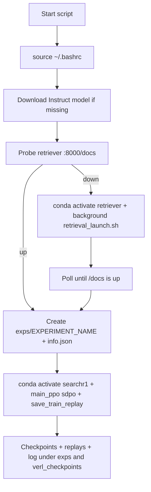

# SDPO training with Qwen2.5-3B-Instruct

## Overview

End-to-end launcher that downloads `Qwen/Qwen2.5-3B-Instruct`, starts the wiki-e5 retriever in the background if it is not already up, runs pure SDPO with v02 hyperparameters plus training-replay JSONL export, and records run metadata under `exps/`.

**Script:** [`scripts/experiments/rui_meng/train_sdpo_v02_instruct_replay.sh`](../../scripts/experiments/rui_meng/train_sdpo_v02_instruct_replay.sh)

## Approach

Reuse the proven pure-SDPO settings from [`train_sdpo_v02.sh`](../../scripts/experiments/rui_meng/train_sdpo_v02.sh) / [`sdpo.yaml`](../../verl/trainer/config/sdpo.yaml), hard-wire Instruct, auto-manage the retriever, enable training-replay JSONL export (same trainer flags as [`train_sdpo_v02_noclip_replay.sh`](../../scripts/experiments/rui_meng/train_sdpo_v02_noclip_replay.sh)), and write experiment artifacts into `exps/`.

**Defaults:**

- Pure SDPO (`--config-name sdpo`)
- Data: `./data/nq_hotpotqa_train`
- Search: `n_agent=5`, `max_turns=4`, `retriever.topk=3`, `total_training_steps=1005`
- Replay: `trainer.save_train_replay=true`
- Clipping: **noclip** — script does not override `ppo_clip`; Hydra `sdpo.yaml` default is `ppo_clip: false` (same as noclip replay scripts)
- Not SDPO+GRPO

## Flow



### 1. Environment bootstrap

- `set -euo pipefail`; `cd` to repo root
- `source ~/.bashrc` so `conda` is on `PATH`
- Envs: `searchr1` (train), `retriever` (server)

### 2. Model download

- Target: `MODEL_DIR="${PROJECT_ROOT}/models/Qwen2.5-3B-Instruct"`
- HF id: `Qwen/Qwen2.5-3B-Instruct`
- If `config.json` is missing:

```bash
conda run -n searchr1 huggingface-cli download Qwen/Qwen2.5-3B-Instruct \
  --local-dir "${MODEL_DIR}"
```

- Pass `actor_rollout_ref.model.path="${MODEL_DIR}"`

### 3. Retriever (background if needed)

- Probe `http://127.0.0.1:${RETRIEVAL_PORT:-8000}/docs`
- If down: start via `conda activate retriever` + `retrieval_launch.sh` in background; log/pid under `exps/`; poll until ready
- If already up: skip launch
- Leave retriever running after training

### 4. SDPO training (+ training replay)

| Setting | Value |
|--------|--------|
| `BASE_MODEL` / model.path | local `models/Qwen2.5-3B-Instruct` |
| `EXPERIMENT_NAME` | `nq_sdpo-qwen2.5-3b-instruct-em-replay` |
| `trainer.default_local_dir` | `verl_checkpoints/${EXPERIMENT_NAME}` |
| `TRAIN_REPLAY_DIR` | `res/train_replays/${EXPERIMENT_NAME}` |
| `trainer.save_train_replay` | `true` |
| `trainer.train_replay_path` | `${TRAIN_REPLAY_DIR}` |
| log tee | `exps/${EXPERIMENT_NAME}/train.log` |
| WandB | if `WANDB_API_KEY_SEARCH_R1` set → `['console','wandb']`; else `['console']` |
| `ppo_clip` | unset → Hydra default `false` (noclip) |

Keep v02 knobs: batch 512 / mini 256 / micro 64, `n_agent=5`, `max_turns=4`, `total_training_steps=1005`.

### 5. Experiment info under `exps/`

Create `exps/nq_sdpo-qwen2.5-3b-instruct-em-replay/` with:

- `info.json` — model, data, retriever, GPUs, `train_replay_dir`, timestamps, git commit, exit code
- `run.sh` — copy of the launcher
- `train.log`
- `retriever.log` / `retriever.pid` — only if this script started the server
- `README.md` — pointers to checkpoints and train replays

## Prerequisites

- `data/nq_hotpotqa_train/{train,test}.parquet`
- `data/wiki18_e5/{e5_Flat.index,wiki-18.jsonl}`
- Conda envs `searchr1`, `retriever`
- GPUs via `CUDA_VISIBLE_DEVICES` (default `0,1,2,3,4,5,6,7`)

## How to run

```bash
cd /root/Search-R1
# optional: export WANDB_API_KEY_SEARCH_R1=...
# optional: TRAIN_REPLAY_DIR=/custom/path
bash scripts/experiments/rui_meng/train_sdpo_v02_instruct_replay.sh
```

## Out of scope

- No SDPO loss / Hydra YAML changes
- No SDPO+GRPO hybrid
- No shorter noclip-only schedule (`TOTAL_TRAINING_STEPS=200`); that stays in `train_sdpo_v02_noclip_replay.sh`
- No automatic data download; fail fast if parquet/index missing
