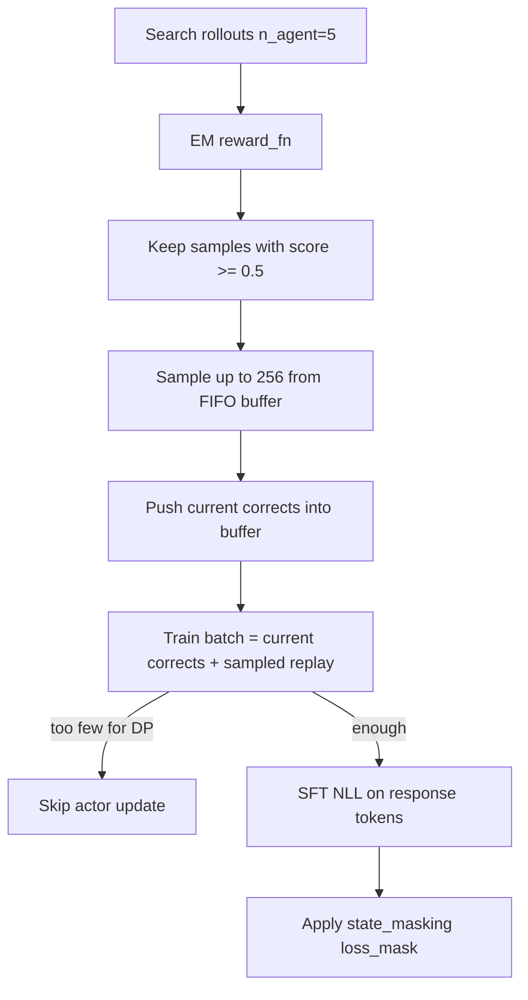
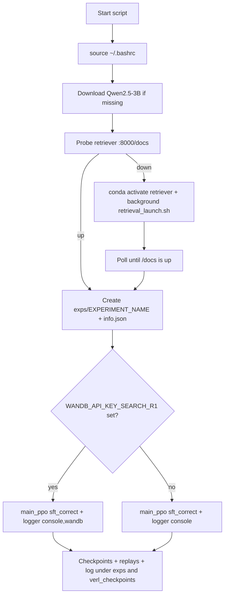

# SFT on correct trajectories with Qwen2.5-3B

## Overview

End-to-end launcher that downloads `Qwen/Qwen2.5-3B`, starts the wiki-e5 retriever in the background if it is not already up, runs **online rejection-SFT** (NLL on EM-correct search rollouts) with an in-training correct-trajectory replay buffer plus training-replay JSONL export, and records run metadata under `exps/`.

**Script (to add):** [`scripts/experiments/rui_meng/train_sft_correct_v02_replay.sh`](../../scripts/experiments/rui_meng/train_sft_correct_v02_replay.sh)

## Approach

Reuse the Search-R1 / SDPO v02 search scaffolding from [`train_sdpo_v02_noclip_replay.sh`](../../scripts/experiments/rui_meng/train_sdpo_v02_noclip_replay.sh) / [`train_sdpo_v02_instruct_replay.sh`](../../scripts/experiments/rui_meng/train_sdpo_v02_instruct_replay.sh), but replace the SDPO self-distillation objective with SFT on EM-correct trajectories, mix past corrects from a FIFO replay buffer, auto-manage the retriever, enable JSONL train-replay export, enable WandB when configured, and write experiment artifacts into `exps/`.

**Defaults:**

- Model: `Qwen/Qwen2.5-3B` (base), not Instruct
- Loss: `policy_loss.loss_mode=sft` (`--config-name sft_correct`)
- Correct = sequence EM reward `>= 0.5`
- Data: `./data/nq_hotpotqa_train`
- Search: `n_agent=5`, `max_turns=4`, `retriever.topk=3`
- Schedule: `total_training_steps=200` (`max_step=200`)
- JSONL replay: `trainer.save_train_replay=true` → `res/train_replays/nq_sft-correct-qwen2.5-3b-em-replay/`
- In-training replay buffer: capacity `4096`, `replay_samples_per_step=256` (**in-memory only**; not checkpointed)
- WandB: enabled when `WANDB_API_KEY_SEARCH_R1` is set
- Not SDPO / SDPO+GRPO

## Training semantics



- **Loss:** `policy_loss = -masked_mean(log_prob, response_mask)` on the mixed SFT batch (reuse `state_masking` / `loss_mask`).
- **Skip** SDPO reprompt / teacher log-prob / `compute_self_distillation_loss`.
- **Skip** GRPO advantage usage for the actor update.
- Steps with zero new corrects can still update from the buffer when it has enough samples.

### Where things are stored

| Artifact | Location | Persisted? |
|----------|----------|------------|
| In-training FIFO replay buffer | Driver process memory (`RayPPOTrainer`) | No — discarded when the job exits |
| JSONL train-replay export | `res/train_replays/nq_sft-correct-qwen2.5-3b-em-replay/step_NNNN.jsonl` | Yes |
| Checkpoints | `verl_checkpoints/nq_sft-correct-qwen2.5-3b-em-replay/` | Yes |
| Run metadata / logs | `exps/nq_sft-correct-qwen2.5-3b-em-replay/` | Yes |

## Implementation

### 1. New loss mode `sft`

- [`verl/workers/actor/dp_actor.py`](../../verl/workers/actor/dp_actor.py): `elif loss_mode == 'sft':` → masked NLL; log `actor/sft_loss`.
- [`verl/trainer/ppo/ray_trainer.py`](../../verl/trainer/ppo/ray_trainer.py):
  - Build `correct_trajectory_mask` from `reward_tensor.sum(-1) >= success_reward_threshold` (default `0.5`).
  - Filter/rebalance the mixed current+buffer batch before `update_actor`.
  - Do not build the SDPO self-distillation batch; still save JSONL via the generic train-replay path.

### 2. Correct-trajectory replay buffer

New helper [`verl/trainer/ppo/correct_trajectory_replay_buffer.py`](../../verl/trainer/ppo/correct_trajectory_replay_buffer.py) owned by `RayPPOTrainer` when `loss_mode=sft`:

- Store CPU copies of SFT fields: `input_ids`, `attention_mask`, `position_ids`, `responses`, `response_mask` / `loss_mask`.
- FIFO capacity default **4096**.
- Each step: sample up to **256** from buffer *before* push → push current corrects → concat for actor update.
- Metrics: `sft/replay_buffer_size`, `sft/num_current_correct`, `sft/num_replay_sampled`, `sft/empty_target_batch`.
- Buffer is driver-only and not persisted across restarts (JSONL train replay remains the durable artifact).

### 3. Hydra preset

Add [`verl/trainer/config/sft_correct.yaml`](../../verl/trainer/config/sft_correct.yaml):

```yaml
defaults:
  - ppo_trainer
  - _self_

actor_rollout_ref:
  actor:
    policy_loss:
      loss_mode: sft
    sft:
      success_reward_threshold: 0.5
      replay_buffer_capacity: 4096
      replay_samples_per_step: 256
    optim:
      lr: 1e-6
    calculate_entropy: true
  rollout:
    n: 4

algorithm:
  adv_estimator: grpo

trainer:
  val_before_train: false
```

### 4. Experiment launcher + artifacts

- Script: `scripts/experiments/rui_meng/train_sft_correct_v02_replay.sh`
- Experiment name: `nq_sft-correct-qwen2.5-3b-em-replay`
- `--config-name sft_correct`
- Batch 512 / mini 256 / micro 64, `n_agent=5`, `max_turns=4`, `retriever.topk=3`, **`total_training_steps=200`**, `state_masking=true`, `use_kl_loss=false`, `save_train_replay=true`
- **WandB support** (same pattern as [`train_sdpo_v02_instruct_replay.sh`](../../scripts/experiments/rui_meng/train_sdpo_v02_instruct_replay.sh)):
  - If `WANDB_API_KEY_SEARCH_R1` is set: `unset WANDB_BASE_URL WANDB_ENTITY`, `export WANDB_API_KEY=...`, `trainer.logger=['console','wandb']`
  - Else: log a notice and use `trainer.logger=['console']` only
  - Always pass `trainer.project_name="${WAND_PROJECT:-Search-R1}"` and `trainer.experiment_name="${EXPERIMENT_NAME}"`
- Model download to `models/Qwen2.5-3B` if missing; auto-start wiki-e5 retriever
- Artifacts under `exps/nq_sft-correct-qwen2.5-3b-em-replay/{info.json,README.md,run.sh,train.log}`
- `info.json` records `train_replay_dir`, replay-buffer hyperparameters, `total_training_steps=200`, and WandB project/experiment names

## Flow



## Prerequisites

- `data/nq_hotpotqa_train/{train,test}.parquet`
- `data/wiki18_e5/{e5_Flat.index,wiki-18.jsonl}`
- Conda envs `searchr1`, `retriever`
- GPUs via `CUDA_VISIBLE_DEVICES` (default `0,1,2,3,4,5,6,7`)

## How to run

```bash
cd /root/Search-R1
export WANDB_API_KEY_SEARCH_R1=...   # enables trainer.logger=['console','wandb']
# optional: WAND_PROJECT=Search-R1
bash scripts/experiments/rui_meng/train_sft_correct_v02_replay.sh
```

## Out of scope

- Offline SFT from exported JSONL / `fsdp_sft_trainer`
- Instruct model variant
- SDPO+GRPO hybrid or using correct demos only as reprompt context
- Changing reward definition (still EM)
- Persisting the in-memory replay buffer across job restarts
- Longer 1005-step schedule (this experiment is fixed at **200** steps)
